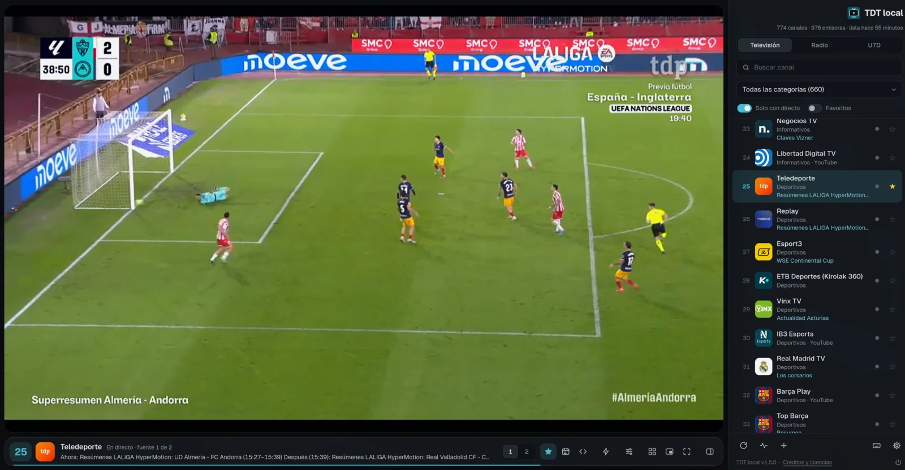
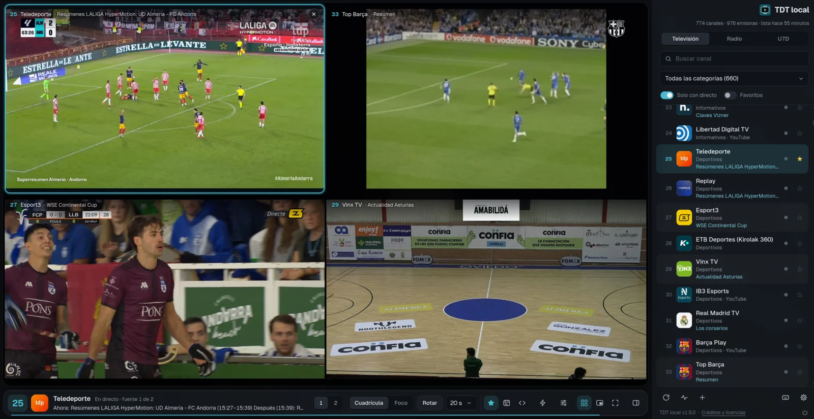
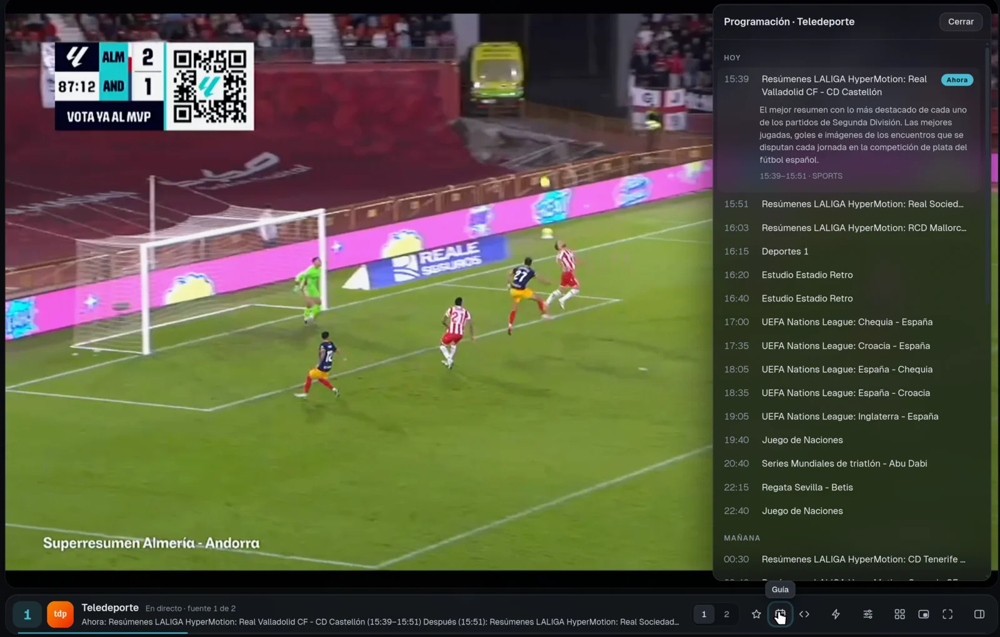
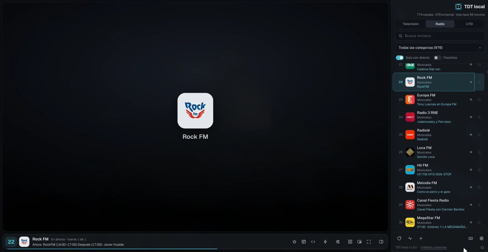
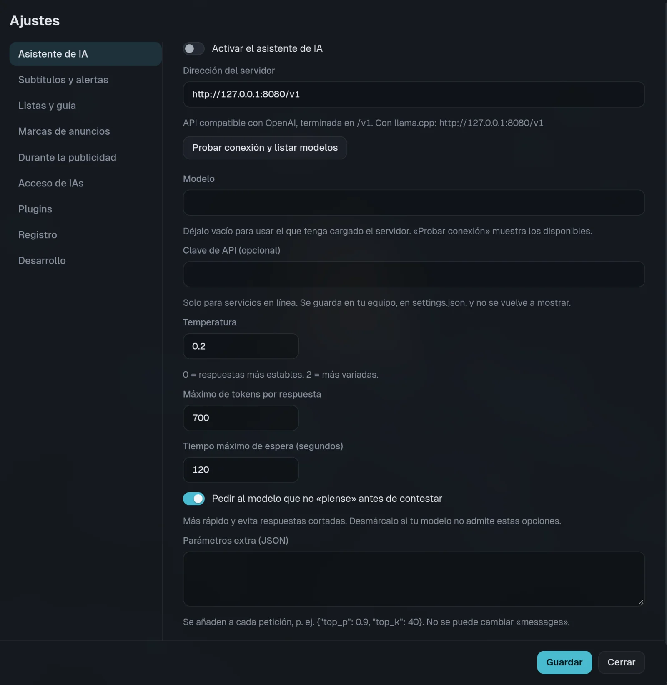
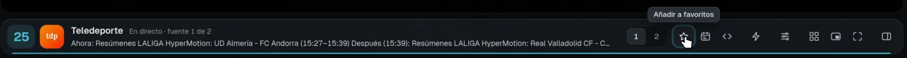
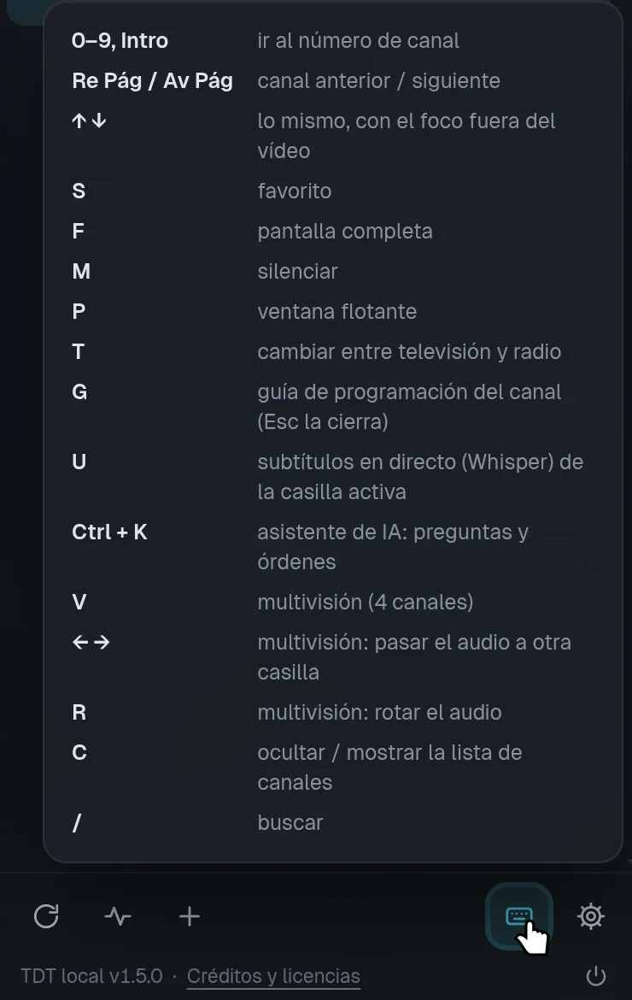

# Modern

Un tema oscuro, limpio y redondeado para TDT local. Es un plugin con todo el poder ([TEMAS.md](../../TEMAS.md),
[HACKEABLE.md](../../HACKEABLE.md)): trae una hoja de estilo (`tema.css`) y un poco de código (`page.js`). Solo funciona en la aplicación de
escritorio.

| | |
|---|---|
|  |  |
|  |  |

## Qué cambia

- **Siempre oscuro**, aunque el sistema esté en modo claro: la imagen es lo más brillante de la pantalla.
- **Superficies en capas y esquinas redondeadas** en la pantalla, la barra de debajo, el panel de canales y los diálogos.
- **Barra bajo la imagen en una sola fila:** el número y el logo del canal, el nombre, lo que dan ahora y después, y botones con icono. El
  nombre de cada botón sale al pasar el ratón por encima. La barra de progreso del programa es una línea fina en el borde de abajo.
- **Botones en grupos:** este canal (Favorito, Guía, Cabeceras, Quitar canal) · herramientas (Asistente, Reglas, Alertas, Marcas) · sonido
  (Sonido, Subtítulos) · vista (Multivisión, Ventana flotante, Pantalla completa) · y Ocultar canales aparte, a la derecha, junto a la lista.
- **Pie del panel en una fila:** Actualizar lista, Comprobar y Añadir canal a la izquierda; los atajos de teclado (en una ventanita) y Ajustes a
  la derecha.
- **Cabecera del panel:** el icono de la aplicación y el nombre a la derecha, y debajo el estado de la lista en una línea.
- **Ajustes con las secciones en una columna a la izquierda;** Guardar y Cerrar siempre a la vista.
- **Interruptores** en lugar de casillas, campos con icono (buscar, desplegables) y paneles de cristal para la guía y el asistente.
- **La página ya no se desplaza en ventanas bajas:** el reproductor se encoge para caber. Con el aspecto de la aplicación, a 1280×720 la
  página es más alta que la ventana y sale una barra de desplazamiento.

## Instalarlo

1. Abre **Ajustes ▸ Plugins ▸ Abrir la carpeta de plugins**.
2. Copia la carpeta `tema-modern` **entera** dentro de esa carpeta. Cada plugin va en su propia carpeta; si copias solo los archivos sueltos,
   la aplicación no los ve.
3. Pulsa **Buscar de nuevo**, marca **Modern** y acepta. La ventana de aprobación enseña la hoja de estilo y el código de `page.js`.

Si cambias cualquier archivo de la carpeta, el tema deja de aplicarse hasta que lo vuelvas a aprobar (desmarcar y marcar).

Las carpetas de plugins, por si quieres llegar sin la aplicación: `%LOCALAPPDATA%\TDT local\desktop\plugins` en Windows,
`~/Library/Application Support/TDT local/desktop/plugins` en macOS y `~/.local/share/tdt-local/desktop/plugins` en Linux.

## Qué hace page.js

- **Pone el logo del canal que se está viendo junto a su número**, bajo la imagen. Lee el canal actual del estado de la aplicación
  (`/js/state.js`) y construye el logo como la lista (`/js/dom.js`), así que sale aunque la lista esté oculta o una búsqueda deje fuera el
  canal. No hace peticiones salvo la del propio logo, que pasa por el servidor local como en la lista.
- **Mueve los botones al orden del tema**, en la propia página, para que la tecla Tab los recorra en el mismo orden en que se ven. Los botones
  que añaden los plugins que se abren sobre la imagen (como Teletexto) van detrás del grupo de vista, con su nombre, y Ocultar canales sigue
  el último.

Al apagar el plugin, el logo se quita y los botones vuelven a su orden.

## Límites

- **Los nombres de los botones están copiados en la hoja** para los avisos al pasar el ratón: si la aplicación cambia el nombre de un botón,
  hay que cambiarlo aquí.
- **`page.js` usa dos módulos internos de la aplicación** (`cur` de `state.js` y `fillLogo` de `dom.js`), que no forman parte del contrato de
  los temas: si cambian, el logo deja de salir. La prueba `tests/js/tema-modern-plugin.test.mjs` avisa si desaparecen, y también si la página
  pierde un `id` que la hoja coloca o `page.js` mueve, o una variable que la hoja lee.
- **En Ajustes, las flechas que cambian de sección son ← y →** (las de la aplicación), aunque las secciones estén en columna.

## Créditos

- Tipografía [Geist](https://vercel.com/font) de Vercel, con la licencia SIL Open Font License 1.1 (`Geist-LICENSE.txt`).
- `icono-app.svg` es una copia del icono de la aplicación (`tdtlocal/static/icon.svg`): un tema solo puede usar archivos de su carpeta.
- Los iconos de los botones están dibujados para este tema y van dentro de la hoja.
